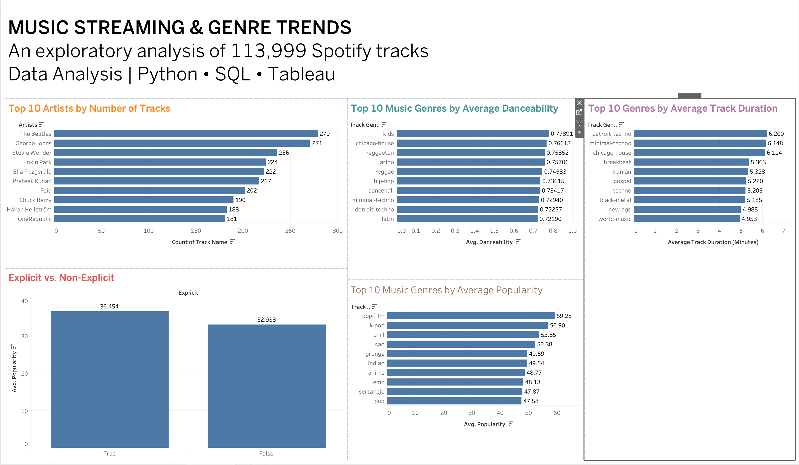

# Music Streaming & Genre Trends Analysis

## Project Overview
An exploratory data analysis project examining 113,999 Spotify tracks to identify patterns in music popularity, genre characteristics, artist representation, and audio features.
## Tableau Dashboard

## Tools & Technologies
- **Python:** Pandas, Matplotlib, Seaborn
- **SQL:** SQLite
- **Data Visualization:** Tableau Public
- **Environment:** Jupyter Notebook

## Key Analyses
- Top 10 music genres by average popularity
- Top 10 genres by average danceability
- Relationship between energy and popularity
- Audio feature correlation analysis
- Top artists by average popularity and track count
- Average track duration by genre
- Explicit vs. non-explicit track popularity

## Key Findings
- Pop-film had the highest average popularity score among the genres analyzed.
- Kids music had the highest average danceability.
- Energy and popularity had almost no linear correlation in this dataset.
- Energy and loudness had a strong positive correlation.
- Explicit tracks had a higher average popularity score than non-explicit tracks.

## Project Files
- `spotify_music_analysis.ipynb` — Python data cleaning, analysis, and visualizations.
- `spotify_analysis.sql` — SQL queries used to explore the dataset.
- Tableau workbook — Interactive dashboard containing five visualizations.

## Dataset
Spotify Tracks Dataset from Kaggle by maharshipandya, containing 114,000 original records. One incomplete record was removed, leaving 113,999 records for analysis.

**Note:** Spotify popularity is a score, not a direct measurement of streams. Observed relationships are descriptive and do not establish causation.

## Project Goal
To develop practical skills in data cleaning, exploratory data analysis, SQL querying, and data visualization while building a portfolio project for data analytics opportunities.
